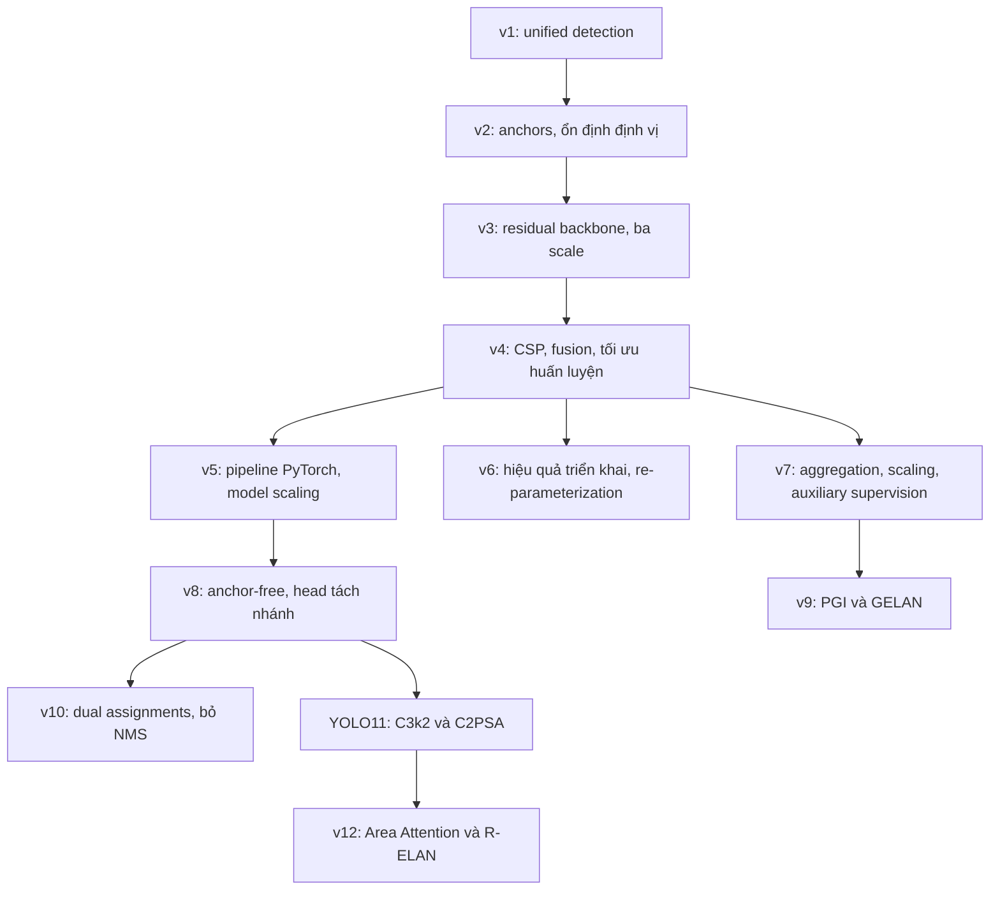

# Quá trình phát triển YOLO từ v1 đến v12

**Personal Task — DPL302m**  
**Baseline paper:** *You Only Look Once: Unified, Real-Time Object Detection* — Joseph Redmon và cộng sự.  
**Phạm vi:** object detection; các tác vụ khác chỉ được nhắc đến khi cần giải thích hướng phát triển của hệ sinh thái.  
**Ngày tổng hợp và truy cập nguồn web:** 13/10/2026.

## 1. Luận điểm và cách đọc quá trình phát triển

YOLOv1 đặt nền tảng bằng cách biến object detection thành một bài toán dự đoán thống nhất: mạng nhìn toàn bộ ảnh, rồi dự đoán vị trí và lớp của các vật thể trong một lần forward. Quá trình phát triển sau đó có thể được giải thích bằng một câu hỏi xuyên suốt:

> Làm thế nào để tăng chất lượng phát hiện mà vẫn giữ được tốc độ phù hợp với ứng dụng thời gian thực?

Các phiên bản trả lời câu hỏi này ở những cấp độ khác nhau: cách biểu diễn bounding box, độ phân giải của đặc trưng, kiến trúc mạng, tín hiệu huấn luyện, chi phí triển khai và khả năng mô hình hóa ngữ cảnh. Vì vậy, báo cáo nối các phiên bản theo **vấn đề → giải pháp → tác động → vấn đề còn lại**, thay vì chỉ liệt kê module.

**YOLO không phải một chuỗi phần mềm do cùng một nhóm phát triển liên tục từ v1 đến v12.** YOLOv1–v3 thuộc nhánh Redmon/Farhadi; YOLOv4 có nhóm tác giả mới; YOLOv5, v8 và YOLO11 thuộc Ultralytics; YOLOv6 thuộc Meituan; YOLOv7/v9 thuộc nhánh Wang và cộng sự; YOLOv10 và v12 là những công trình của các nhóm khác. Danh sách tác giả và nguồn của từng phiên bản nằm ở mục 2 và 8.

Trong tài liệu này, “chuyển từ phiên bản A sang B” thường chỉ **sự chuyển dịch trọng tâm kỹ thuật khi đọc theo thời gian**, không mặc định B kế thừa toàn bộ kiến trúc của A. Những liên kết được nêu như “mạch lý giải” là phần tổng hợp của báo cáo; những module và phương pháp cụ thể được dẫn về paper hoặc mã nguồn.

Nguồn chính là mười PDF trong `../../YOLO_Paper/`, gồm hai tài liệu cho YOLOv6. Với v5, v8 và v11, báo cáo dùng tài liệu và repository chính thức. Riêng v8 và YOLO11, Ultralytics xác nhận chưa phát hành formal research paper trên trang tài liệu của từng model; vì vậy chúng được trích dẫn dưới dạng tài liệu/phần mềm, không gán cho một paper survey bên thứ ba. [Nguồn YOLOv8](https://docs.ultralytics.com/models/yolov8/), [nguồn YOLO11](https://docs.ultralytics.com/models/yolo11/).

## 2. Bản đồ thời gian và các nhánh phát triển

| Phiên bản | Mốc thời gian | Nhóm/nguồn chính | Trọng tâm khi đặt trong tiến trình |
| --- | --- | --- | --- |
| YOLOv1 | Preprint 2015; CVPR 2016 | Redmon, Divvala, Girshick, Farhadi | Thống nhất detection bằng một mạng dự đoán trực tiếp |
| YOLOv2 / YOLO9000 | Preprint 2016; CVPR 2017 | Redmon, Farhadi | Cải thiện recall, định vị, độ ổn định; mở rộng số lớp |
| YOLOv3 | 2018 | Redmon, Farhadi | Backbone residual và dự đoán trên ba mức đặc trưng |
| YOLOv4 | 2020 | Bochkovskiy, Wang, Liao | Tối ưu đồng thời kiến trúc và cách huấn luyện |
| YOLOv5 | Repository công khai 2020 | Ultralytics | Phát triển pipeline PyTorch và nhiều kích thước model |
| YOLOv6 | 2022; bản v3.0 năm 2023 | Meituan | Thiết kế cho hiệu quả triển khai công nghiệp |
| YOLOv7 | Preprint 2022; CVPR 2023 | Wang, Bochkovskiy, Liao | Layer aggregation, scaling và trainable bag-of-freebies |
| YOLOv8 | 10/01/2023 | Ultralytics | Anchor-free, head tách nhánh và hệ sinh thái thống nhất |
| YOLOv9 | 2024 | Wang, Yeh, Liao | Chất lượng gradient với PGI và kiến trúc GELAN |
| YOLOv10 | 2024 | Ao Wang và cộng sự | Detection không cần NMS và tối ưu toàn pipeline |
| YOLO11 | 27/09/2024 | Ultralytics | Cải thiện khối đặc trưng và bổ sung attention có chọn lọc |
| YOLOv12 | 2025 | Tian, Ye, Doermann | Attention trở thành trọng tâm thiết kế detector |

Mốc công bố repository v5 lấy từ [release notes v1.0](https://github.com/ultralytics/yolov5/releases/tag/v1.0); ngày phát hành v8 và YOLO11 lấy từ [tài liệu v8](https://docs.ultralytics.com/models/yolov8/) và [tài liệu YOLO11](https://docs.ultralytics.com/models/yolo11/). Các mốc paper xem tài liệu tham khảo ở mục 8. Cần phân biệt năm preprint với năm hội nghị: chẳng hạn v7 là công trình xuất hiện năm 2022 dù PDF trong thư mục là bản CVPR 2023.

### 2.1. Sơ đồ mạch kỹ thuật

Các mũi tên dưới đây thể hiện **mạch phân tích**, không phải cây kế thừa mã nguồn.

Sơ đồ làm rõ ba hướng song song: **pipeline dễ sử dụng**, **huấn luyện/triển khai hiệu quả**, và **biểu diễn đặc trưng tốt hơn**. Một model có thể tiếp thu ý tưởng từ nhiều hướng mà không trở thành bản nâng cấp trực tiếp của model mang số nhỏ hơn gần nhất.

## 3. Giai đoạn nền tảng: từ phát hiện thống nhất đến đặc trưng đa tỉ lệ

### 3.1. YOLOv1 — Thiết lập baseline

**Vấn đề ban đầu.** Các pipeline dựa trên region proposals cần nhiều bước để tìm vùng, phân loại và tinh chỉnh box. YOLOv1 xây dựng một mạng dự đoán thống nhất trên toàn ảnh, giảm sự phân mảnh của pipeline và đạt tốc độ phù hợp với xử lý video.

**Cách hoạt động.** Với cấu hình PASCAL VOC trong paper:

- Ảnh đầu vào có kích thước `448 × 448`.
- Ảnh được chia thành lưới `S × S`, với `S = 7`.
- Ô chứa tâm vật thể chịu trách nhiệm dự đoán vật thể đó.
- Mỗi ô dự đoán `B = 2` bounding boxes, mỗi box gồm `(x, y, w, h, confidence)`.
- Mỗi ô có một bộ xác suất lớp dùng chung cho các box, với `C = 20`.

Do đó, đầu ra là:

\[
S \times S \times (B\cdot 5+C)
=7\times 7\times 30.
\]

Confidence trong paper kết hợp xác suất tồn tại vật thể và IoU; điểm của một lớp đối với box được hình thành bằng cách nhân confidence với xác suất lớp có điều kiện. Mạng chính có 24 convolutional layers và 2 fully connected layers. Khi suy luận, dự đoán vẫn được xử lý bằng **NMS**. “Một lần nhìn” chỉ nói đến forward của mạng, không đồng nghĩa không có hậu xử lý. [Paper v1, §2–2.3](../../YOLO_Paper/V1.pdf).

**Huấn luyện.** Loss là tổng squared errors cho tọa độ, confidence và xác suất lớp. Paper tăng trọng số tọa độ bằng `λ_coord = 5`, giảm trọng số confidence ở vùng không có vật thể bằng `λ_noobj = 0.5`, và dùng căn bậc hai của chiều rộng/chiều cao để điều chỉnh ảnh hưởng của kích thước box.

**Điểm mạnh.** Mạng sử dụng ngữ cảnh toàn ảnh; paper ghi nhận ít lỗi nhầm background thành object hơn Fast R-CNN và khả năng khái quát sang ảnh nghệ thuật. YOLO đầy đủ đạt 63.4 mAP trên VOC 2007 và 45 FPS trong thiết lập của tác giả; Fast YOLO đạt 52.7 mAP và 155 FPS. Đây là kết quả của hai model riêng, không phải hai chế độ của cùng model. [Paper v1, §3, Table 1](../../YOLO_Paper/V1.pdf).

**Hạn chế tạo động lực phát triển.** Lưới thô và xác suất lớp dùng chung trong mỗi ô gây khó khăn cho các vật thể nhỏ nằm gần nhau. Biểu diễn box và fully connected prediction layers thiếu linh hoạt; loss tọa độ chưa bám trực tiếp vào chất lượng overlap. Paper xác định lỗi định vị là nguồn lỗi chính. [Paper v1, §2.4](../../YOLO_Paper/V1.pdf).

**Cầu nối tới v2:** baseline đã chứng minh detection có thể nhanh, nhưng cần tăng recall và ổn định định vị mà không đánh đổi lợi thế này.

### 3.2. YOLOv2 / YOLO9000 — Cải thiện cách dự đoán box

YOLOv2 giải quyết các hạn chế v1 bằng cả cách biểu diễn box lẫn cách huấn luyện:

| Thay đổi | Cơ chế và ý nghĩa |
| --- | --- |
| Batch normalization | Cải thiện hội tụ và regularization |
| High-resolution classifier | Cho backbone thích nghi với độ phân giải cao trước khi học detection |
| Fully convolutional prediction | Bỏ fully connected prediction layers, hỗ trợ đầu vào linh hoạt hơn |
| Anchor boxes | Dự đoán dựa trên các hình dạng box tham chiếu; tạo nhiều ứng viên hơn |
| Dimension clustering | Dùng k-means với khoảng cách `1 − IoU` để chọn anchor phù hợp dữ liệu |
| Direct location prediction | Giới hạn tâm box trong quan hệ với ô lưới để ổn định quá trình học |
| Passthrough layer | Đưa đặc trưng độ phân giải cao xuống mức dự đoán để giữ chi tiết |
| Multi-scale training | Thay đổi kích thước ảnh khi train, hỗ trợ đánh đổi tốc độ–độ chính xác |

Backbone **Darknet-19** hỗ trợ mục tiêu giảm computation. Với đầu vào `416 × 416`, mức dự đoán có kích thước `13 × 13`. So với v1, objectness và dự đoán lớp được gắn với từng anchor thay vì chỉ có một bộ xác suất lớp dùng chung cho ô. [Paper v2, §2–3](../../YOLO_Paper/V2.pdf).

Một kết quả ablation đáng chú ý: chuyển sang anchors ban đầu làm recall tăng từ 81% lên 88% nhưng mAP giảm nhẹ từ 69.5 xuống 69.2. Điều này cho thấy **anchor không tự động cải thiện tất cả chỉ số**; cần kết hợp dimension priors và cơ chế định vị ổn định. [Paper v2, §2](../../YOLO_Paper/V2.pdf).

**YOLOv2 khác YOLO9000.** YOLOv2 là detector được cải tiến. YOLO9000 kết hợp detection data với classification data qua **WordTree**, khai thác quan hệ phân cấp giữa các lớp để mở rộng số danh mục. Đây là một hướng mở rộng khả năng học nhãn, không phải bằng chứng mọi lớp mới đều có độ chính xác detection tương đương lớp được huấn luyện bằng box. [Paper v2, §4](../../YOLO_Paper/V2.pdf).

**Vấn đề còn lại:** passthrough giúp giữ chi tiết nhưng detector vẫn chủ yếu dự đoán tại một mức đặc trưng. Vật thể có nhiều kích thước cần cách biểu diễn đa tỉ lệ mạnh hơn.

**Cầu nối tới v3:** từ “nhiều box tại một scale” sang “dự đoán trực tiếp trên nhiều mức đặc trưng”.

### 3.3. YOLOv3 — Đưa multi-scale prediction thành thành phần cốt lõi

YOLOv3 dùng **Darknet-53**, với residual connections để tăng khả năng biểu diễn và hỗ trợ huấn luyện backbone sâu hơn. Detector dự đoán box trên **ba mức đặc trưng**, kết hợp upsampling và concatenation theo ý tưởng feature pyramid. Với ảnh `416 × 416`, ba mức thường là `13 × 13`, `26 × 26`, `52 × 52`; mỗi mức dùng ba anchors. [Paper v3, §2.1–2.4](../../YOLO_Paper/V3.pdf).

Sự thay đổi này giải quyết một mâu thuẫn của detector: đặc trưng sâu mang ngữ nghĩa tốt nhưng độ phân giải thấp; đặc trưng nông có chi tiết vị trí nhưng ngữ nghĩa yếu hơn. Kết hợp chúng giúp model dùng cả thông tin lớp và vị trí, đặc biệt cho vật thể nhỏ.

YOLOv3 dùng independent logistic classifiers và binary cross-entropy cho lớp thay cho softmax, hỗ trợ các nhãn có thể chồng lấp về ngữ nghĩa. Head vẫn là kiểu anchor-based với dự đoán box, objectness và lớp, và vẫn dùng NMS. [Paper v3, §2.1–2.2](../../YOLO_Paper/V3.pdf).

**Tác động và giới hạn.** Paper ghi nhận khả năng phát hiện vật thể nhỏ tốt hơn trước. Tuy nhiên, model mạnh ở AP50 hơn ở các IoU thresholds cao: box tìm được vật thể nhưng chưa luôn khớp chính xác với biên của nó. Vì vậy, không nên mô tả v3 là đã giải quyết hoàn toàn small-object detection hoặc localization. [Paper v3, §3](../../YOLO_Paper/V3.pdf).

**Cầu nối tới v4:** kiến trúc đa tỉ lệ đã hình thành; bước tiếp theo là cải thiện hiệu quả sử dụng đặc trưng và huấn luyện toàn hệ thống, thay vì chỉ tăng độ sâu backbone.

## 4. Giai đoạn tối ưu hệ thống: kiến trúc, huấn luyện và triển khai

### 4.1. YOLOv4 — Tối ưu một tổ hợp kỹ thuật

YOLOv4 đặt mục tiêu tạo detector chính xác, nhanh và có thể huấn luyện bằng một GPU thông dụng. Cấu hình chính kết hợp **CSPDarknet53**, **SPP**, **PAN** và detection head theo YOLOv3. [Paper v4, §3](../../YOLO_Paper/V4.pdf).

- **CSP:** chia và kết hợp các đường xử lý đặc trưng để cải thiện hiệu quả tính toán và luồng gradient.
- **SPP:** tổng hợp context ở các phạm vi pooling khác nhau.
- **PAN:** bổ sung đường truyền đặc trưng từ dưới lên, hỗ trợ chuyển thông tin định vị giữa các mức.

Đóng góp quan trọng về cách tiếp cận là phân biệt:

| Nhóm kỹ thuật | Ý nghĩa | Ví dụ trong cấu hình YOLOv4 |
| --- | --- | --- |
| Bag of Freebies — BoF | Tăng chất lượng qua huấn luyện, không tăng chi phí kiến trúc suy luận | Mosaic, Self-Adversarial Training, CIoU loss, các điều chỉnh regularization/training |
| Bag of Specials — BoS | Thay đổi kiến trúc hoặc suy luận, chấp nhận chi phí bổ sung để tăng hiệu quả | SPP, PAN, modified SAM, activation và phương pháp NMS được lựa chọn |

**Mosaic** ghép bốn ảnh, tạo thêm biến thiên context và tỉ lệ. **CIoU loss** đưa overlap, khoảng cách tâm và aspect ratio vào mục tiêu hồi quy box, khắc phục một phần khoảng cách giữa loss tọa độ và chất lượng định vị. Paper khảo sát nhiều lựa chọn; không phải mọi phương pháp trong related work đều thuộc cấu hình cuối. [Paper v4, §2–4](../../YOLO_Paper/V4.pdf).

**Vấn đề còn lại:** thiết kế tốt trong benchmark cần được hiện thực thành pipeline dễ train, mở rộng kích thước và triển khai. Đồng thời, FLOPs thấp chưa bảo đảm latency thấp trên hardware cụ thể.

**Cầu nối:** v5 nhấn mạnh kỹ thuật phần mềm và pipeline; v6/v7 phát triển các giải pháp cho hiệu quả kiến trúc và huấn luyện. Đây là các hướng song song sau thời kỳ v4.

### 4.2. YOLOv5 — Đưa thiết kế YOLO vào pipeline thực dụng

YOLOv5 là nhánh Ultralytics dựa trên PyTorch. Release notes ghi nhận phát triển các model dựa trên YOLOv3/v4 và mở repository năm 2020. Đóng góp nổi bật là biến detector thành pipeline train–validate–inference–export có nhiều kích thước model. [Release notes](https://github.com/ultralytics/yolov5/releases/tag/v1.0), [repository chính thức](https://github.com/ultralytics/yolov5).

Về kiến trúc, các bản v5 phổ biến dùng CSP/C3, fusion theo FPN/PAN và head anchor-based tại ba mức. Cấu hình tag `v6.0` có **C3**, **SPPF** và `Detect` với anchors. SPPF dùng pooling nối tiếp để tổng hợp context hiệu quả. [Cấu hình v5s tại tag v6.0](https://github.com/ultralytics/yolov5/blob/v6.0/models/yolov5s.yaml).

Về huấn luyện, tài liệu mô tả AutoAnchor, Mosaic, multi-scale training, EMA và mixed precision. **AutoAnchor** điều chỉnh anchors theo dữ liệu; **EMA** ổn định bộ trọng số được đánh giá; mixed precision hỗ trợ giảm chi phí training. [Tài liệu kiến trúc v5](https://docs.ultralytics.com/yolov5/tutorials/architecture-description/).

**Cần ghi rõ revision.** Focus thuộc các bản đầu; bản sau thay bằng convolution `6 × 6`. SPP cũng được thay bằng SPPF. Không nên ghép toàn bộ các thay đổi này thành “kiến trúc v5 lúc ra mắt”. [Tài liệu kiến trúc v5](https://docs.ultralytics.com/yolov5/tutorials/architecture-description/).

**YOLOv5 gốc khác YOLOv5u:** v5 gốc là anchor-based; v5u tích hợp head anchor-free/objectness-free theo hướng v8. Báo cáo này dùng **v5 gốc** khi mô tả lịch sử. [Tài liệu YOLOv5u](https://docs.ultralytics.com/models/yolov5/).

**Cầu nối tới v6/v8:** pipeline thuận tiện chưa loại bỏ chi phí của anchors hoặc bảo đảm tốc độ trên hardware đích. Hai câu hỏi tiếp theo là thiết kế mạng hợp triển khai và đơn giản hóa detection head.

### 4.3. YOLOv6 — Thiết kế theo yêu cầu triển khai công nghiệp

YOLOv6 chuyển trọng tâm từ “mạng có ít phép tính” sang **mạng có cấu trúc chạy hiệu quả trên phần cứng triển khai**. Công trình dùng EfficientRep backbone và Rep-PAN neck, kết hợp structural re-parameterization: khi train, block có nhiều nhánh; khi deploy, các nhánh tuyến tính tương thích được gộp thành cấu trúc convolution đơn giản hơn. Với model lớn, paper dùng các biến thể CSP để cân bằng biểu diễn và chi phí. [Paper v6, §2.1](../../YOLO_Paper/V6.pdf).

Detection head là **anchor-free** và **decoupled**, tách nhánh phân loại và định vị. Paper cũng nghiên cứu label assignment, loss, self-distillation và quantization để tăng hiệu quả toàn hệ thống. Điều này cho thấy hướng anchor-free trong tập tài liệu đã có ở v6; không nên nói v8 là phiên bản đầu tiên khởi xướng nó. [Paper v6, §2.2–2.4](../../YOLO_Paper/V6.pdf).

#### Bản cập nhật YOLOv6 v3.0

File `V6-3.pdf` mô tả một lần nâng cấp của nhánh v6, không phải phiên bản YOLO mới mang số 6.3. Các đóng góp chính:

- **RepBi-PAN / Bi-directional Concatenation:** kết hợp thêm đặc trưng mức thấp, tăng tín hiệu định vị, đặc biệt có ích cho vật thể nhỏ.
- **SimCSPSPPF:** cải thiện tổng hợp đặc trưng trong thiết kế CSP.
- **Anchor-Aided Training — AAT:** dùng nhánh anchor-based phụ khi train để hỗ trợ nhánh anchor-free; suy luận vẫn sử dụng nhánh anchor-free.
- **Decoupled Localization Distillation — DLD:** ở model nhỏ, nhánh hồi quy phụ nặng hơn hỗ trợ học và được loại khi suy luận.
- **P6 variants:** bổ sung stage để khai thác đầu vào độ phân giải cao.

[Paper v6 v3.0, §2](../../YOLO_Paper/V6-3.pdf).

**Bài học:** cấu trúc train và deploy không cần giống nhau. Có thể tăng độ phong phú của tín hiệu học nhưng giữ đường suy luận gọn.

**Giới hạn:** lợi ích re-parameterization và quantization phụ thuộc backend, precision và thiết bị. Không thể suy ra model nhanh hơn chỉ từ số tham số hoặc FLOPs.

### 4.4. YOLOv7 — Tổ chức aggregation và giám sát huấn luyện

YOLOv7 tập trung vào thiết kế đường truyền đặc trưng/gradient và cách mở rộng mạng. **E-ELAN** mở rộng aggregation bằng cơ chế expand, shuffle và merge cardinality, nhằm tăng khả năng học mà giữ đặc điểm đường gradient. Paper còn đề xuất compound scaling phù hợp mạng dựa trên concatenation: thay đổi depth làm thay đổi số kênh đưa vào transition layers, nên cần điều chỉnh width tương ứng. [Paper v7, §3](../../YOLO_Paper/V7.pdf).

Trainable bag-of-freebies gồm hai ý quan trọng:

1. **Planned re-parameterization:** chọn vị trí và dạng RepConv theo cấu trúc residual/concatenation, tránh áp dụng cùng một block vào mọi nơi.
2. **Lead-head-guided label assignment:** sử dụng prediction của head chính để hỗ trợ tạo nhãn cho head chính và head phụ; cơ chế coarse-to-fine cung cấp tập positive rộng hơn cho nhánh phụ.

[Paper v7, §4](../../YOLO_Paper/V7.pdf).

V7 chia sẻ với v6 nguyên tắc “train phong phú, inference gọn”, nhưng nhấn mạnh aggregation, scaling và auxiliary supervision. **YOLOv7 gốc vẫn dùng anchor-based detection**; chuyển dịch anchor-free không diễn ra đồng loạt ở tất cả nhánh. [Configuration chính thức của v7](https://raw.githubusercontent.com/WongKinYiu/yolov7/main/cfg/training/yolov7.yaml).

**Lưu ý biến thể:** E-ELAN là đóng góp nổi bật của paper, nhưng không nên đồng nhất mọi cấu hình v7/tiny/W6/E6 với một sơ đồ block duy nhất. Khi mô tả triển khai cụ thể cần kiểm tra configuration tương ứng.

**Cầu nối tới v9:** tổ chức đường gradient tốt dẫn tới câu hỏi sâu hơn: tín hiệu gradient có giữ được thông tin cần thiết cho mục tiêu học hay không?

## 5. Giai đoạn hiện đại: head, gradient, hậu xử lý và attention

### 5.1. YOLOv8 — Đơn giản hóa head và thống nhất hệ sinh thái

YOLOv8 tiếp tục nhánh Ultralytics với **anchor-free split head** và pipeline hỗ trợ nhiều tác vụ. Mốc phát hành là tháng 01/2023. [Tài liệu v8](https://docs.ultralytics.com/models/yolov8/).

Cấu hình detection có **C2f**, SPPF, các đường upsample/concatenation rồi downsample/fusion và ba đầu ra P3–P5. C2f tạo các đường đặc trưng để kết hợp kết quả trung gian trong khối CSP. [Cấu hình v8 tại tag v8.3.0](https://raw.githubusercontent.com/ultralytics/ultralytics/v8.3.0/ultralytics/cfg/models/v8/yolov8.yaml).

Head tách dự đoán lớp khỏi hồi quy box. Hồi quy dự đoán phân phối khoảng cách tới các cạnh box và dùng **Distribution Focal Loss — DFL**; loss detection dùng **Task-Aligned Assigner**, CIoU và BCE. Những thành phần này được xác nhận trong implementation, không phải các phát minh đầu tiên của v8. [Detection head](https://raw.githubusercontent.com/ultralytics/ultralytics/v8.3.0/ultralytics/nn/modules/head.py), [loss implementation](https://raw.githubusercontent.com/ultralytics/ultralytics/v8.3.0/ultralytics/utils/loss.py).

**Anchor-free** bỏ các mẫu box có width/height định trước; model vẫn dự đoán trên điểm của feature maps. Do đó, biến mang tên `anchor_points` trong code không làm model trở thành anchor-based. Head này không có nhánh objectness riêng như v5 gốc. [Detection head](https://raw.githubusercontent.com/ultralytics/ultralytics/v8.3.0/ultralytics/nn/modules/head.py).

**Vấn đề còn lại:** nhiều prediction vẫn có thể cùng mô tả một vật thể; pipeline detection thông thường của v8 vẫn dùng NMS. [NMS implementation](https://raw.githubusercontent.com/ultralytics/ultralytics/v8.3.0/ultralytics/utils/ops.py).

**Cầu nối:** v9 cải thiện tín hiệu học; v10 xử lý prediction dư và chi phí NMS. Hai vấn đề này độc lập với việc bỏ anchor boxes.

### 5.2. YOLOv9 — Cải thiện thông tin dùng để học

YOLOv9 đặt vấn đề **information bottleneck**: qua nhiều lớp biến đổi, mạng có thể mất thông tin cần thiết cho nhiệm vụ, khiến gradient tính từ đầu ra chưa đủ đáng tin cậy để cập nhật trọng số hiệu quả. Công trình không chỉ mở rộng backbone, mà can thiệp vào cách hình thành tín hiệu huấn luyện. [Paper v9, §3](../../YOLO_Paper/V9.pdf).

**Programmable Gradient Information — PGI** gồm:

- **Main branch:** đường mạng dùng khi suy luận.
- **Auxiliary reversible branch:** hỗ trợ tạo gradient có thông tin tốt hơn khi train.
- **Multi-level auxiliary information:** phối hợp tín hiệu giám sát ở các mức để hạn chế tích lũy lỗi.

Nhánh phụ được loại khi suy luận; không nên mô tả YOLOv9 deploy như một mạng phải giữ toàn bộ các nhánh reversible. **GELAN — Generalized Efficient Layer Aggregation Network** kết hợp ý tưởng CSP và ELAN, hỗ trợ nhiều computational blocks với thiết kế đường gradient hiệu quả. PGI là cơ chế học; GELAN là thiết kế kiến trúc. [Paper v9, §4.1–4.2](../../YOLO_Paper/V9.pdf).

**Quan hệ với v7:** v7 tổ chức đường gradient và auxiliary supervision; v9 phát triển thành một khung giám sát nhắm tới chất lượng thông tin của gradient. Đây là mối nối kỹ thuật rõ hơn việc coi v9 đơn giản là v8 lớn hơn.

**Vấn đề còn lại:** cải thiện representation và training chưa loại bỏ hậu xử lý. Prediction dư vẫn là bài toán cần xử lý riêng.

### 5.3. YOLOv10 — Tối ưu cả forward và hậu xử lý

YOLOv10 nhận diện hai nguồn chi phí: kiến trúc có computation dư và pipeline cần NMS vì cách gán nhãn one-to-many. Nếu chỉ đo network forward, một phần latency thực tế bị bỏ sót. [Paper v10, §1](../../YOLO_Paper/V10.pdf).

**Consistent dual assignments** kết hợp hai nhánh khi train:

| Nhánh | Vai trò khi huấn luyện | Vai trò khi suy luận |
| --- | --- | --- |
| One-to-many | Nhiều positive predictions cho mỗi ground truth, cung cấp giám sát phong phú | Được loại |
| One-to-one | Học lựa chọn prediction đại diện cho mỗi object | Tạo đầu ra không cần NMS |

Hai nhánh sử dụng matching metrics nhất quán để phối hợp hướng tối ưu. NMS-free ở đây là kết quả của cách huấn luyện và assignment, không phải thao tác xóa NMS khỏi một v8 đã train theo cách cũ. [Paper v10, §3.1](../../YOLO_Paper/V10.pdf).

Về kiến trúc, paper bổ sung lightweight classification head, spatial-channel decoupled downsampling và rank-guided block design để giảm redundancy; large-kernel convolution và partial self-attention giúp tăng năng lực biểu diễn với chi phí được kiểm soát. [Paper v10, §3.2](../../YOLO_Paper/V10.pdf).

**Liên hệ baseline:** v1 “end-to-end” theo nghĩa cùng học các thành phần detection trong một mạng, nhưng vẫn dùng NMS. V10 tiến thêm tới đầu ra detection không cần NMS. Hai cách dùng từ “end-to-end” cần được phân biệt.

**Giới hạn:** NMS-free vẫn có thể cần decode, lọc confidence và chọn top predictions. Không nên diễn đạt thành “không có bất kỳ hậu xử lý nào”. Chi phí thực tế vẫn phụ thuộc export và runtime.

### 5.4. YOLO11 — Tinh chỉnh nhánh Ultralytics và dùng attention có chọn lọc

Tên chính thức của model là **YOLO11**. Đây là bước tiếp theo của nhánh Ultralytics, với trọng tâm cải thiện biểu diễn trong một pipeline quen thuộc. Tài liệu báo cáo YOLO11m có AP cao hơn YOLOv8m và ít hơn khoảng 22% tham số; đây là so sánh hai biến thể `m`, không phải kết luận cho mọi kích thước model. [Tài liệu YOLO11](https://docs.ultralytics.com/models/yolo11/).

Cấu hình tag `v8.3.0` dùng **C3k2**, SPPF và **C2PSA**; vẫn có fusion đa tỉ lệ và `Detect` tại P3, P4, P5. C3k2 thay đổi khối xử lý đặc trưng; C2PSA bổ sung xử lý dựa trên partial attention. [Cấu hình YOLO11](https://raw.githubusercontent.com/ultralytics/ultralytics/v8.3.0/ultralytics/cfg/models/11/yolo11.yaml), [module implementation](https://raw.githubusercontent.com/ultralytics/ultralytics/v8.3.0/ultralytics/nn/modules/block.py).

Với cấu hình detection này, head dùng `Detect`, không dùng head `v10Detect`. Luồng suy luận thông thường vẫn cần NMS. Vì vậy **YOLO11 không tự động kế thừa NMS-free từ YOLOv10**. [Detection head](https://raw.githubusercontent.com/ultralytics/ultralytics/v8.3.0/ultralytics/nn/modules/head.py), [NMS implementation](https://raw.githubusercontent.com/ultralytics/ultralytics/v8.3.0/ultralytics/utils/ops.py).

**Cầu nối tới v12:** attention đã xuất hiện có chọn lọc trong detector. Câu hỏi tiếp theo là liệu nó có thể trở thành thành phần trung tâm mà vẫn đáp ứng latency thời gian thực.

### 5.5. YOLOv12 — Thiết kế attention theo ràng buộc thời gian thực

YOLOv12 không chỉ thêm attention vào một CNN. Công trình đặt attention ở trung tâm thiết kế, đồng thời điều chỉnh aggregation và implementation để kiểm soát chi phí và ổn định training. Paper local được đọc là **arXiv:2502.12524v1, 18/02/2025**. [Paper v12](../../YOLO_Paper/V12.pdf).

**Area Attention.** Feature map được chia thành các vùng dạng dải theo chiều ngang hoặc dọc. Với số vùng mặc định `l = 4`, mỗi vùng vẫn có receptive field tương đối lớn nhưng số tương tác attention giảm. Nếu có `N` tokens được chia đều thành `l` vùng, phần tính tương tác tỉ lệ với:

\[
l\left(\frac{N}{l}\right)^2=\frac{N^2}{l}.
\]

Đây là giảm hệ số chi phí so với global attention; với `l` cố định, không phải biến attention thành thuật toán có độ phức tạp tuyến tính theo `N`. [Paper v12, §3.2](../../YOLO_Paper/V12.pdf).

**R-ELAN — Residual Efficient Layer Aggregation Networks.** Attention gây thêm khó khăn tối ưu ở các model lớn. R-ELAN đưa residual connection qua block, kết hợp scaling và thay đổi cách aggregation để cải thiện hội tụ và giảm chi phí. Paper kế thừa hai stage đầu của backbone từ YOLO11; không thay toàn bộ convolution bằng attention. [Paper v12, §3.3–3.4](../../YOLO_Paper/V12.pdf).

**Điều chỉnh implementation.** Công trình sử dụng FlashAttention để giảm chi phí truy cập bộ nhớ; điều chỉnh MLP ratio; dùng convolution và batch normalization; bỏ positional embeddings thông thường nhưng dùng convolution `7 × 7` dạng separable làm **position perceiver**. Vì vậy “bỏ positional encoding” không có nghĩa model bỏ khả năng sử dụng thông tin vị trí. [Paper v12, §3.4 và §4.5](../../YOLO_Paper/V12.pdf).

**Tác động và giới hạn.** Kết quả trong paper cho thấy attention có thể cạnh tranh về accuracy–latency trong thiết lập GPU của tác giả. Paper cũng nêu phụ thuộc FlashAttention/hardware và quan sát model cần training dài hơn để đạt kết quả tốt. Không nên suy từ đó rằng attention luôn nhanh hơn CNN trên mọi thiết bị. [Paper v12, §4–6](../../YOLO_Paper/V12.pdf).

**V12 không mặc nhiên NMS-free.** Đóng góp trung tâm của paper là attention và aggregation, không phải consistent dual assignments của v10. Trong repository tác giả được kiểm tra, configuration dùng `Detect` thông thường. File trên nhánh `main` hiện ghi `YOLOv12-turbo`, nên chỉ dùng để đối chiếu code hiện hành; không dùng số FLOPs/params của nó thay cho bảng kết quả PDF v1. [Cấu hình repository tác giả](https://raw.githubusercontent.com/sunsmarterjie/yolov12/main/ultralytics/cfg/models/v12/yolov12.yaml).

## 6. Tổng hợp logic giữa các phiên bản

### 6.1. Bảng “vấn đề → giải pháp → bước phát triển”

Bảng này là **phần tổng hợp của báo cáo** từ các nguồn đã dẫn trong mục 3–5; cột cuối mô tả động lực nghiên cứu, không khẳng định paper tiếp theo được tạo ra chỉ để sửa phiên bản liền trước.

| Mốc | Vấn đề nổi bật | Giải pháp chính | Câu hỏi còn lại / hướng tiếp theo |
| --- | --- | --- | --- |
| v1 | Pipeline detection nhiều bước | Một mạng dự đoán box và lớp trên toàn ảnh | Recall, box localization và object nhỏ |
| v2 | Ít ứng viên, định vị khó học | Anchors, clustering, direct location, BN | Một mức dự đoán chưa đủ cho nhiều kích thước |
| v3 | Thiếu ngữ nghĩa/chi tiết ở các scale | Darknet-53 và ba detection scales | Fusion, hiệu quả mạng và localization chính xác |
| v4 | Nhiều kỹ thuật chưa được phối hợp hiệu quả | CSP + SPP + PAN; BoF/BoS | Pipeline thuận tiện và deployment efficiency |
| v5 | Cần train/deploy và scale model thuận tiện | PyTorch pipeline, nhiều kích thước, AutoAnchor | Anchors và latency trên hardware đích |
| v6 | Computation chưa phù hợp triển khai | Re-parameterization, anchor-free decoupled head | Tăng chất lượng mà giữ đường inference gọn |
| v7 | Scaling/aggregation ảnh hưởng gradient và hardware | E-ELAN, compound scaling, auxiliary supervision | Độ tin cậy của thông tin dùng tính gradient |
| v8 | Head anchor-based và pipeline tác vụ cần đơn giản hóa | C2f, anchor-free split head, TAL/DFL | Prediction trùng và chi phí NMS |
| v9 | Mất thông tin khi học qua mạng sâu | PGI và GELAN | Training tốt chưa loại bỏ hậu xử lý |
| v10 | NMS và redundancy tăng latency | Consistent dual assignments; tối ưu kiến trúc | Cân bằng biểu diễn, assignment và chi phí thực tế |
| YOLO11 | Cần representation tốt trong nhánh Ultralytics | C3k2 và C2PSA | Mở rộng vai trò attention với chi phí hợp lý |
| v12 | Attention mạnh nhưng đắt và khó tối ưu | Area Attention, R-ELAN, implementation hiệu quả | Tính khả chuyển hardware và chi phí training |

### 6.2. Bốn trục phát triển xuyên suốt

**Trục 1 — Dự đoán và định vị.** V1 dùng trực tiếp tọa độ theo ô; v2–v5 khai thác anchor boxes; v6/v8 phát triển anchor-free và tách nhánh head; v10 thay đổi assignment để hỗ trợ đầu ra không cần NMS. Đây là nhiều quyết định khác nhau: anchor-free không đồng nghĩa decoupled, và cả hai không đồng nghĩa NMS-free.

**Trục 2 — Biểu diễn đa tỉ lệ và ngữ cảnh.** Từ lưới v1, passthrough v2 đến pyramid v3; sau đó CSP/SPP/PAN trong v4 và các khối aggregation mới. YOLO11 và v12 mở rộng mô hình hóa quan hệ bằng attention. Việc mọi model nhìn toàn ảnh đầu vào không làm context biểu diễn của v1 tương đương attention interactions của v12.

**Trục 3 — Chất lượng huấn luyện.** Từ squared-error loss và assignment đơn giản của v1 đến BoF ở v4, distillation/re-parameterization ở v6, auxiliary supervision ở v7, TAL/DFL ở v8 và PGI ở v9. Nhiều cải tiến đạt được bằng cách học tốt hơn thay vì tăng model deploy.

**Trục 4 — Hiệu quả thực tế.** Tốc độ ban đầu chủ yếu được trình bày bằng FPS; các công trình sau chú ý thêm runtime, precision, quantization, memory access và NMS. V12 cho thấy FLOPs chưa mô tả đầy đủ hiệu quả attention; v10 cho thấy network latency chưa mô tả đầy đủ pipeline latency.

### 6.3. Đối chiếu với baseline YOLOv1

| Thành phần | Baseline v1 | Sự phát triển sau baseline |
| --- | --- | --- |
| Ý tưởng detection | Unified prediction trong một forward | Được giữ như nguyên tắc chung của họ YOLO |
| Không gian dự đoán | Lưới 7 × 7, một mức | Feature pyramids và nhiều detection levels |
| Class prediction | Bộ xác suất lớp dùng chung trong ô | Theo anchor/prediction point; các head tách nhánh |
| Box representation | Tọa độ trực tiếp, số box giới hạn | Anchor offsets rồi khoảng cách tới các cạnh box |
| Backbone | CNN với prediction layers fully connected | Fully convolutional, residual, CSP, aggregation, attention |
| Box loss | Squared errors | Các IoU-based losses và distribution-based regression |
| Giám sát | Predictor chịu trách nhiệm theo IoU | Matching động, auxiliary branches, distillation, PGI, dual assignments |
| Hậu xử lý | NMS | NMS vẫn phổ biến; v10 là mốc NMS-free đáng chú ý |
| Đánh giá hiệu quả | mAP và FPS trong thiết lập paper | AP nhiều thresholds, latency, throughput và điều kiện runtime |

**Luận điểm dùng cho Personal Task:** giá trị bền vững của YOLOv1 là cách thống nhất detection và ưu tiên tốc độ. Các hạn chế của thiết kế cụ thể—lưới thô, chia sẻ xác suất lớp, hồi quy tọa độ và biểu diễn một scale—tạo động lực cho nhiều hướng nghiên cứu. Các thế hệ sau giữ nguyên mục tiêu nhưng thay đổi dần cách tạo đặc trưng, dự đoán và học.

## 7. Cách sử dụng tài liệu trong bài viết và thuyết trình

### 7.1. Dàn ý gợi ý

1. **Giới thiệu bài toán:** yêu cầu real-time detection và ý tưởng của YOLOv1.
2. **Phân tích baseline:** lưới, output tensor, confidence, loss, inference và lỗi điển hình.
3. **Khắc phục hạn chế biểu diễn:** v2 tăng recall/ổn định; v3 dự đoán đa tỉ lệ.
4. **Tối ưu hệ thống:** v4 phối hợp kỹ thuật; v5 xây pipeline; v6/v7 tối ưu deploy và train.
5. **Các câu hỏi hiện đại:** v8 thay head; v9 cải thiện gradient; v10 bỏ NMS.
6. **Hướng attention:** YOLO11 dùng có chọn lọc; v12 thiết kế attention-centric.
7. **Thảo luận:** so sánh các trục kỹ thuật và chỉ ra mục tiêu tốc độ–độ chính xác xuyên suốt.

Không cần dành dung lượng bằng nhau cho mọi phiên bản. V1 nên được phân tích sâu vì là baseline paper; các model sau cần làm rõ chúng thay đổi giả định nào của baseline và đóng góp gì cho tiến trình.

### 7.2. Đoạn tổng hợp có thể phát triển thành phần kết luận

YOLOv1 mở đầu hướng phát hiện vật thể bằng một mạng thống nhất với chi phí suy luận thấp. YOLOv2 cải thiện biểu diễn box và ổn định định vị, còn YOLOv3 đưa dự đoán đa tỉ lệ thành thành phần cốt lõi để xử lý biến thiên kích thước vật thể. Từ YOLOv4, tiến trình mở rộng sang tối ưu cả kiến trúc, huấn luyện và triển khai, với nhiều nhánh phát triển song song. Các thế hệ sau đặt ra những câu hỏi riêng: làm sao đơn giản hóa head, duy trì gradient có thông tin, giảm prediction dư và khai thác attention trong giới hạn latency. Do đó, lịch sử YOLO nên được nhìn như sự mở rộng dần phạm vi tối ưu—từ output representation đến toàn bộ detection pipeline—trên nền mục tiêu chung là cân bằng chất lượng phát hiện và tốc độ thực tế.

### 7.3. Các điểm cần giữ chính xác khi so sánh

- **Không trộn metric:** VOC mAP ở IoU 0.5 khác COCO AP trung bình trên IoU 0.50:0.05:0.95. Không dùng một bảng mAP chung để suy ra mức tăng liên tục từ v1 đến v12.
- **Không trộn điều kiện tốc độ:** GPU, precision, input size, batch size, runtime và phạm vi đo phải tương thích. Throughput FPS của batch lớn không tương đương latency cho một ảnh.
- **Ghi rõ biến thể và revision:** v5 ban đầu khác v5 v6.0/v5u; v6 khác v6 v3.0; configuration hiện hành v12-turbo khác PDF v12 v1.
- **Không gán quyền khởi xướng sai:** BN, CSP, PAN, DFL, TAL, re-parameterization và attention có nguồn gốc nghiên cứu riêng. Tích hợp vào YOLO không đồng nghĩa phát minh lần đầu.
- **Không coi số phiên bản là mức vượt trội tuyệt đối:** khả năng phù hợp tác vụ/hardware cần đánh giá bằng thí nghiệm cùng điều kiện.
- **Phân biệt đọc paper với tái lập:** báo cáo này là tổng hợp tài liệu, chưa train hoặc benchmark lại các model.

## 8. Tài liệu tham khảo và truy vết nguồn

### 8.1. Paper có sẵn trong thư mục

Các liên kết local tính từ vị trí file Markdown này.

| ID | Phiên bản | Tài liệu | File local | Bản online |
| --- | --- | --- | --- | --- |
| P1 | v1 | Redmon et al., *You Only Look Once: Unified, Real-Time Object Detection* | [V1.pdf](../../YOLO_Paper/V1.pdf) | [arXiv:1506.02640](https://arxiv.org/abs/1506.02640) |
| P2 | v2 | Redmon & Farhadi, *YOLO9000: Better, Faster, Stronger* | [V2.pdf](../../YOLO_Paper/V2.pdf) | [arXiv:1612.08242](https://arxiv.org/abs/1612.08242) |
| P3 | v3 | Redmon & Farhadi, *YOLOv3: An Incremental Improvement* | [V3.pdf](../../YOLO_Paper/V3.pdf) | [arXiv:1804.02767](https://arxiv.org/abs/1804.02767) |
| P4 | v4 | Bochkovskiy et al., *YOLOv4: Optimal Speed and Accuracy of Object Detection* | [V4.pdf](../../YOLO_Paper/V4.pdf) | [arXiv:2004.10934](https://arxiv.org/abs/2004.10934) |
| P6 | v6 | Li et al., *YOLOv6: A Single-Stage Object Detection Framework for Industrial Applications* | [V6.pdf](../../YOLO_Paper/V6.pdf) | [arXiv:2209.02976](https://arxiv.org/abs/2209.02976) |
| P6.3 | v6 v3.0 | Li et al., *YOLOv6 v3.0: A Full-Scale Reloading* | [V6-3.pdf](../../YOLO_Paper/V6-3.pdf) | [arXiv:2301.05586](https://arxiv.org/abs/2301.05586) |
| P7 | v7 | Wang et al., *YOLOv7: Trainable bag-of-freebies sets new state-of-the-art for real-time object detectors* | [V7.pdf](../../YOLO_Paper/V7.pdf) | [arXiv:2207.02696](https://arxiv.org/abs/2207.02696) |
| P9 | v9 | Wang et al., *YOLOv9: Learning What You Want to Learn Using Programmable Gradient Information* | [V9.pdf](../../YOLO_Paper/V9.pdf) | [arXiv:2402.13616](https://arxiv.org/abs/2402.13616) |
| P10 | v10 | Ao Wang et al., *YOLOv10: Real-Time End-to-End Object Detection* | [V10.pdf](../../YOLO_Paper/V10.pdf) | [arXiv:2405.14458](https://arxiv.org/abs/2405.14458) |
| P12 | v12 | Tian et al., *YOLOv12: Attention-Centric Real-Time Object Detectors* | [V12.pdf](../../YOLO_Paper/V12.pdf) | [arXiv:2502.12524v1](https://arxiv.org/abs/2502.12524v1) |

### 8.2. Nguồn web chính thức bổ sung cho v5, v8, YOLO11

| ID | Nguồn | Dùng để xác nhận |
| --- | --- | --- |
| W5a | [YOLOv5 repository](https://github.com/ultralytics/yolov5) | Pipeline PyTorch và chức năng hệ sinh thái |
| W5b | [YOLOv5 release v1.0](https://github.com/ultralytics/yolov5/releases/tag/v1.0) | Mốc lịch sử và định hướng ban đầu |
| W5c | [YOLOv5 architecture description](https://docs.ultralytics.com/yolov5/tutorials/architecture-description/) | Training, SPPF, thay đổi Focus và SPP |
| W5d | [YOLOv5s YAML, tag v6.0](https://github.com/ultralytics/yolov5/blob/v6.0/models/yolov5s.yaml) | C3, SPPF, anchors và ba detection scales |
| W5e | [YOLOv5u documentation](https://docs.ultralytics.com/models/yolov5/) | Phân biệt v5 gốc với biến thể v5u |
| W8a | [YOLOv8 documentation](https://docs.ultralytics.com/models/yolov8/) | Ngày phát hành, split head, publication status |
| W8b | [YOLOv8 YAML, tag v8.3.0](https://raw.githubusercontent.com/ultralytics/ultralytics/v8.3.0/ultralytics/cfg/models/v8/yolov8.yaml) | C2f, SPPF và fusion P3–P5 |
| W11a | [YOLO11 documentation](https://docs.ultralytics.com/models/yolo11/) | Ngày phát hành, publication status và so sánh biến thể m |
| W11b | [YOLO11 YAML, tag v8.3.0](https://raw.githubusercontent.com/ultralytics/ultralytics/v8.3.0/ultralytics/cfg/models/11/yolo11.yaml) | C3k2, C2PSA và Detect head |
| WC1 | [head.py, tag v8.3.0](https://raw.githubusercontent.com/ultralytics/ultralytics/v8.3.0/ultralytics/nn/modules/head.py) | Detect, DFL, class/box branches và v10Detect |
| WC2 | [loss.py, tag v8.3.0](https://raw.githubusercontent.com/ultralytics/ultralytics/v8.3.0/ultralytics/utils/loss.py) | TAL, CIoU, DFL và BCE |
| WC3 | [block.py, tag v8.3.0](https://raw.githubusercontent.com/ultralytics/ultralytics/v8.3.0/ultralytics/nn/modules/block.py) | C3k2 và C2PSA |
| WC4 | [ops.py, tag v8.3.0](https://raw.githubusercontent.com/ultralytics/ultralytics/v8.3.0/ultralytics/utils/ops.py) | NMS trong đường suy luận thông thường |

Các file mã nguồn gắn tag giúp cố định revision khi đọc kiến trúc. Các trang documentation có thể thay đổi theo thời gian; ngày truy cập ghi ở đầu báo cáo. Nguồn code v12 trên `main` chỉ là đối chiếu bổ sung và đã được phân biệt với paper local.
